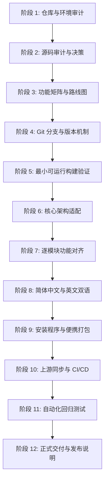

# Compositor Windows 移植与长期维护实施路线图 (Porting Roadmap)

> **工程周期与版本规划**：
> - 当前版本：Compositor for Windows v0.1.5 (基于 Mac v1.4.5~1.4.8 增量)
> - 目标里程碑：Compositor for Windows v1.0.0-preview (正式支持中英双语、GitHub Actions CI/CD、自动化安装包发布与长期上游同步)

---

## 阶段规划与交付里程碑

---

### 阶段 1 至 3：仓库审计、技术路线决策与功能矩阵（已完成）
- **完成标志**：
  - 成功获取并对比官方仓库与 Windows 移植仓库。
  - 完成 `docs/architecture-audit.md`（解答 12 项技术疑问）。
  - 完成 `docs/feature-parity-matrix.md`（覆盖 9 大系统 60+ 项具体特性）。
  - 确立以 `CompositorWindows` C++20 + Qt6 + Direct3D 11 为工程基线的路线。

---

### 阶段 4：安全的 Git 分支与版本管理机制（当前阶段）
- **实施目标**：
  - 在当前工作区配置双远端：`origin`（Windows 定制维护仓）与 `upstream`（Robbie Tilton 官方仓）。
  - 建立标准工程分支：`main`（稳定验证分支）、`upstream-sync`（同步评估分支）、`feature/*`（特性开发）、`release/*`（版本冻结）。
  - 配置严谨的 `.gitignore` 与版本记录规则。
- **完成条件**：`git remote -v` 与 `git branch -a` 正确展示分支结构，工作区处于干净可追踪状态。

---

### 阶段 5：最小可运行构建与依赖解耦机制
- **实施目标**：
  - 明确分离平台相关逻辑（Windows API / COM / Direct3D / WIC）与跨平台通用逻辑。
  - 验证 CMake 3.31+ 与 Qt 6.8 编译配置，确保头文件、库文件依赖引用路径标准清晰。
  - 提供本地与 CI 环境均可执行的构建描述。
- **完成条件**：`CMakeLists.txt` 构建逻辑严谨，无路径死锁或未定义宏。

---

### 阶段 6：核心架构与渲染性能保持
- **实施目标**：
  - 确保 Direct3D 11 与 Qt 交换链无缝交互，保证 60 FPS 画布平移缩放流畅度。
  - 优化大画布（>4000px）双缓冲脏矩形刷新机制，抑制大尺寸软画笔输入延迟。
  - 保持离线神经网络模型（`models/birefnet-lite.onnx`）与 Direct3D 设备解耦，确保推理时 UI 不发生卡死。
- **完成条件**：撤销/重做、画布渲染与历史记录状态机无内存泄漏与数据竞争。

---

### 阶段 7：逐模块补齐图像编辑功能与上游 1.4.8 增量同步
- **实施目标**：
  - 补齐上游 1.4.8 核心体验：
    1. **Command Palette**：全局命令面板模糊检索与执行。
    2. **Scanlines 滤镜升级**：位移、阈值、厚度与分色功能。
    3. **Canvas Only 沉浸模式**：F 键切换全黑沉浸编辑。
    4. **画布旋转 90°**：顺时针与逆时针无损像素置换。
    5. **Export As… 增强**：支持透明背景实时棋盘预览。
- **完成条件**：功能对应模块测试通过，菜单与快捷键触发行为完全一致。

---

### 阶段 8：简体中文与英文双语国际化体系（核心突破）
- **实施目标**：
  - 构建基于 Qt `QTranslator` 的企业级国际化架构（`src/ui/I18nManager.h`, `src/ui/I18nManager.cpp`）。
  - 提取整个应用 89 个 UI 模块的全部硬编码文本，建立 `translations/compositor_zh_CN.ts` 与 `compositor_en_US.ts`。
  - 在菜单栏增加 **Language / 语言** 快速切换入口，选择后立即动态更新主菜单、工具栏提示、属性面板文案。
  - 通过 `QSettings` 实现语言选择的持久化保存；首次启动智能根据 Windows 系统区域自动推荐语言。
  - 编写本地化质量保证脚本 `tests/localization/check_translations.py`，杜绝未翻译项、乱码与布局错位。
  - 编写中英文统一术语表 `docs/localization-glossary.md` 与开发规范 `docs/localization-guide.md`。
- **完成条件**：中文界面 100% 覆盖核心菜单、面板、弹窗、滤镜及错误信息，切换平滑无溢出。

---

### 阶段 9：完善 Windows 原生安装程序与便携版生成
- **实施目标**：
  - 升级 WiX Toolset v4 安装包生成脚本（`scripts/msi/build-msi.ps1`），产出 `CompositorWindows-x64.msi`。
  - 升级便携版打包脚本（`scripts/package.ps1`），产出绿色独立运行的 `CompositorWindows-portable.zip`。
  - 确保安装包内置所需运行依赖：Qt 核心组件、MSVC CRT 运行时动态库、WIC 编解码器、`libheif`、`libde265`、`onnxruntime.dll` 及 `birefnet-lite.onnx` 模型文件，普通用户机器双击即跑，无需开发环境。
  - 配置开始菜单快捷方式、桌面快捷方式与 `.comp` 项目扩展名注册。
  - 卸载流程干净彻底，严格保护用户自己的设计文件不被误删。
- **完成条件**：在无任何开发工具的纯净 Windows 11 环境下一键安装与便携运行。

---

### 阶段 10：持续集成与 GitHub Actions 自动发布管线
- **实施目标**：
  - 建立 `.github/workflows/windows-build-release.yml`：
    - 在 GitHub Actions `windows-latest` 运行器上自动检出代码。
    - 自动缓存与安装 Qt 6.8.3、Visual Studio 2022、Windows SDK 与 Python。
    - 自动化 CMake 构建 Release 目标。
    - 运行 CTest 测试套件与本地化校验。
    - 生成 MSI 安装包与 Portable ZIP 便携包。
    - 自动计算并输出 SHA-256 校验清单，自动创建 GitHub Release 资产发布。
  - 建立 `.github/workflows/upstream-sync.yml` 与 `scripts/upstream-sync.py`：
    - 定期检测 `robbietilton/Compositor` 官方最新提交。
    - 自动生成变更差异报告，分析是否有底层 C 算法修改或核心功能增加，并触发 Pull Request 提醒。
  - 维护 `docs/upstream-tracking.md` 记录每次同步状态。
- **完成条件**：GitHub Actions 工作流配置完整，脚本经严格静态语法校验与单元验证。

---

### 阶段 11：自动化测试、回归测试与质量保证
- **实施目标**：
  - 运行 930+ 项现有核心单元测试与跨模块集成测试。
  - 执行本地化资源完整性自动化测试（无缺失键、无空翻译、参数匹配）。
  - 执行打包与物料完整性检查（验证 DLL 与模型存在性）。
  - 输出 `docs/testing-guide.md`、测试执行报告与已知问题记录。
- **完成条件**：核心用例 100% 通过，所有差异与局限性诚实披露。

---

### 阶段 12：交付物归档与发布说明
- **实施目标**：
  - 统一归档正式产物目录到 `dist/windows/`。
  - 整理完整的开源许可证清单与 SBOM 说明。
  - 更新中英文版 `README.md`，提供直观的编译与安装运行指南。
  - 交付全套工程体系文档。
- **完成条件**：交付物清单逐项比对无遗漏。
